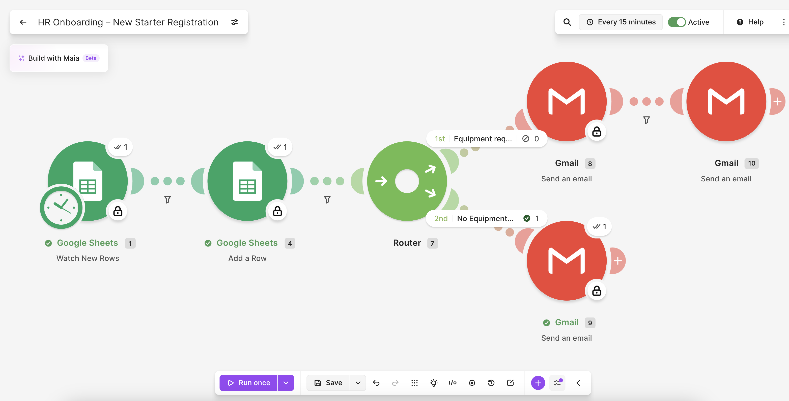

# HR-Onboarding-Workflow-Automation

**Project status:** In Progress — Working Prototype

## Overview

This project demonstrates how a basic HR onboarding workflow can be automated using Google Forms, Google Sheets, Make and Gmail.

A hiring manager submits new starter information through a form. The automation adds the employee to a central register and sends email notifications based on whether additional equipment is required.

This is a practical learning project exploring workflow automation, application integrations and conditional logic in an HR context.

## Objectives

- Reduce manual data entry during new starter registration.
- Maintain a centralised Employee Register.
- Automate notifications to hiring managers and IT.
- Use conditional logic to handle different equipment requirements.

## Tools and Technologies

- **Google Forms** — collects new starter information.
- **Google Sheets** — stores form responses and maintains the Employee Register.
- **Make** — connects applications and automates the workflow.
- **Gmail** — sends automated email notifications.

## Workflow

1. A hiring manager submits a Google Form with the new employee's details.
2. Make detects the new submission in the Google Sheets response sheet.
3. The employee's information is added to the Employee Register.
4. A router evaluates whether additional equipment is required.
5. The workflow follows one of two routes:
   - **Equipment required:** an IT equipment request is sent to IT, and a confirmation is sent to the hiring manager.
   - **No equipment required:** a confirmation is sent to the hiring manager; no IT equipment request is sent.

## Workflow Diagram

## Form and Employee Register

The form collects employee details, job information, start date, work location, equipment requirements and hiring manager contact details.

Conditional branching displays the equipment selection question only when additional equipment is required.

The Employee Register stores the submitted information in a structured format. The work email field is left blank at registration because it may be created later by IT. New records are assigned the status **Pending**.

## Automation Logic

The Make scenario uses:

- **Google Sheets — Watch New Rows:** detects new form submissions.
- **Google Sheets — Add a Row:** creates an employee record.
- **Router and filters:** direct the workflow according to the equipment requirement.
- **Gmail — Send an Email:** sends the relevant notifications.

## Testing

The workflow has been tested using fictional employee records.

| Test scenario | Employee Register | Manager notification | IT notification |
|---|---|---|---|
| Equipment required — Yes | Record created | Sent | Sent |
| Equipment required — No | Record created | Sent | Not sent |

Both conditional routes have been tested successfully. Scheduled automatic execution is still to be confirmed.

## Project Demo

- [Open the demo Google Form](https://docs.google.com/forms/d/e/1FAIpQLSebD3Y_TTKWWue2DWfuVchHewrdi1Zv0QpVgCtGqwFEjOnkqg/viewform)
- [View the Make automation](https://eu1.make.com/public/shared-scenario/0yqRe8QpSoC/hr-onboarding-new-starter-registration)

## Screenshots

Screenshots of the form, Employee Register, Make scenario, routing conditions, notifications and test results will be added to the `screenshots` folder.

## Skills Demonstrated

- HR process analysis
- Workflow automation
- No-code application integration
- Conditional logic and routing
- Data collection and organisation
- Automated email notifications
- Workflow testing and troubleshooting

## Future Improvements

- Validate mandatory fields and identify missing or inconsistent information.
- Explore AI-assisted data checks.
- Improve the workflow structure and reduce duplicated modules.

- Extend the workflow with additional onboarding steps.

## Notes

This is a learning project using fictional employee data. It is a prototype and is not intended for processing real employee information or replacing an organisation's HR system.
